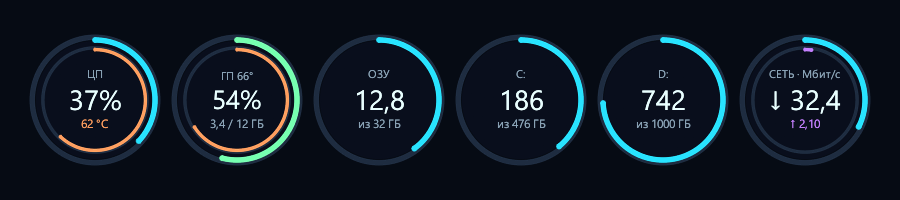
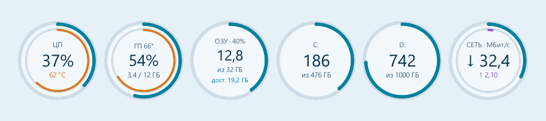
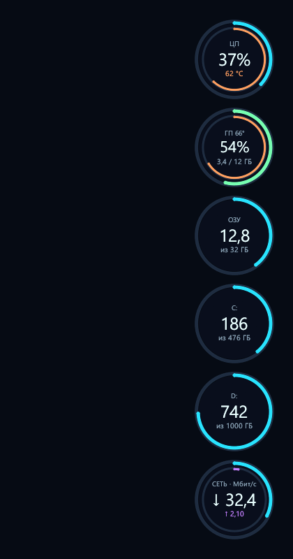
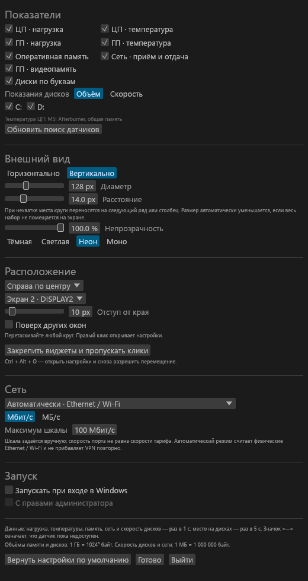
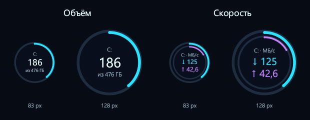
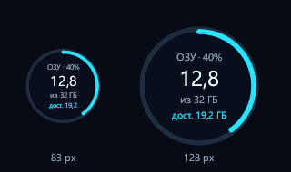

<h1 align="center">Orbit Widgets</h1>

Круглые виджеты производительности для рабочего стола Windows.

<a href="README.md">English</a> · <strong>Русский</strong>

Orbit Widgets показывает нагрузку и температуру ЦП и ГП, использование оперативной памяти, занятое место и текущую скорость чтения и записи дисков, сетевой трафик в прозрачных кругах. Оформление **«Двойной контур»** объединяет связанные показания без общей фоновой панели. Интерфейс приложения — на русском языке.

**[Скачать последнюю версию](https://github.com/feogrim-cloud/OrbitWidgets/releases/latest)** · [Сборка из исходников](docs/BUILD.md) · [Сообщить об ошибке](https://github.com/feogrim-cloud/OrbitWidgets/issues)

*Настоящий интерфейс с демонстрационными показаниями. Нейтральная подложка помогает показать прозрачные виджеты и не является панелью приложения. Нажмите на картинку, чтобы открыть её в полном размере.*

## Скачать

Для **Windows 10 версии 2004 и новее и Windows 11, Intel/AMD x64**.

| Вариант | Скачать | Как использовать |
| --- | --- | --- |
| Установщик | [OrbitWidgets-Setup-x64.exe](https://github.com/feogrim-cloud/OrbitWidgets/releases/latest/download/OrbitWidgets-Setup-x64.exe) | Установить программу, при необходимости установить драйвер датчиков ЦП и создать ярлык на рабочем столе. |
| Переносной ZIP | [OrbitWidgets-Windows-x64.zip](https://github.com/feogrim-cloud/OrbitWidgets/releases/latest/download/OrbitWidgets-Windows-x64.zip) | Полностью распаковать в постоянную папку и запустить `OrbitWidgets.exe`. |

Папка `sensors` должна оставаться рядом с программой. Для готовых пакетов средства разработки не нужны. Модуль датчиков использует .NET Framework 4.7.2 или новее. Исполняемые файлы Orbit Widgets пока не подписаны; отдельный официальный установщик драйвера PawnIO подписан его издателем. К релизу прилагаются контрольные суммы SHA-256.

Сборки для Windows x86, Windows ARM64 и Linux не предоставляются. Автоматического обновления нет.

## Галерея интерфейса

**Светлая тема**

<table>
  <tr><th>Вертикально у правого края</th><th>Настройки показателей и оформления</th></tr>
  <tr>
    <td align="center"></td>
    <td align="center"></td>
  </tr>
</table>

**Объём и текущая скорость диска при размере 83 и 128 px**

**Занятая и доступная ОЗУ при размере 83 и 128 px**

## Возможности

- **ЦП и ГП:** внешнее кольцо показывает нагрузку, внутреннее — температуру. Для графического процессора используется подпись **ГП**.
- **Оперативная память:** процент занятой памяти в заголовке, занятый объём в центре, общий объём под ним и доступная физическая память нижней строкой того же круга. Внешнее кольцо показывает заполненность; подсказка также перечисляет все объёмы с единицами. Доступная память включает возвращаемую часть кэша Windows. Все показания ОЗУ берутся из одного снимка раз в секунду.
- **Диски:** переключатель **«Объём / Скорость»** для занятого/общего объёма либо текущих скоростей чтения и записи по каждой букве, с отдельными переключателями видимости. Внешнее кольцо всегда показывает заполненность; в режиме скорости внутреннее — сумму чтения и записи относительно настраиваемой шкалы, по умолчанию 1000 МБ/с. Это не процент загрузки диска.
- **Сеть:** текущие приём и отдача в **Мбит/с или МБ/с**, автоматический выбор Ethernet/Wi-Fi либо конкретный адаптер, настраиваемый максимум кольцевой шкалы. Это трафик адаптера, включая локальную сеть, а не проверка предельной скорости Интернета.
- Отдельное включение нагрузки, температуры, памяти, дисков и сети.
- Вертикальное и горизонтальное размещение, перенос кругов при нехватке места, настройка размера, расстояния и непрозрачности.
- Четыре темы: тёмная, светлая, неон и монохромная.
- Выбор монитора, привязка к краям и углам экрана, свободное перемещение, режим поверх других окон.
- Закрепление с пропуском кликов мыши, значок в области уведомлений и глобальные сочетания клавиш.
- Автозапуск при входе в Windows, в том числе с правами администратора через Планировщик заданий.
- Подробности при наведении в отдельном окне, которое помещается в рабочей области монитора, в том числе при вертикальном расположении кругов у правого края.

Новый профиль размещает виджеты **вертикально, справа по центру дополнительного монитора**, если он подключён. При обновлении существующие расположение и оформление сохраняются.

## Начало работы

1. Запустите установщик либо полностью распакуйте переносной ZIP и откройте `OrbitWidgets.exe`.
2. Нажмите правой кнопкой по любому кругу, чтобы открыть настройки. Выберите показатели, размещение, тему и монитор.
3. Перетащите любой круг для свободного перемещения всей группы либо выберите привязку к краю экрана.
4. Включите **«Поверх других окон»**, если показания должны оставаться видимыми поверх обычных окон на этом мониторе.

| Действие | Управление |
| --- | --- |
| Открыть настройки и разрешить взаимодействие | `Ctrl` + `Alt` + `O` |
| Включить или выключить закрепление с пропуском кликов | `Ctrl` + `Alt` + `L` |
| Открыть настройки | Правый клик по кругу или значок в области уведомлений |
| Закрыть программу | Меню значка в области уведомлений → **«Выход»** |

Нагрузка и температуры ЦП/ГП, видеопамять, ОЗУ, сеть, скорости чтения и записи дисков обновляются **раз в секунду**, занятое место на дисках — раз в пять секунд. Скорости дисков поступают из системных счётчиков Windows LogicalDisk. При недоступном счётчике показан **«—»**, при простое скорость может быть нулевой. Плавное движение колец не зависит от частоты опроса. Для объёмов памяти и дисков используются двоичные гигабайты (1024³ байт) с подписью **ГБ**; для скорости дисков и сети мегабайт равен 1 000 000 байт, а 1 МБ/с соответствует 8 Мбит/с.

В настройках включите **«Диски по буквам»** и выберите **«Объём»** либо **«Скорость»**. В режиме скорости **↓** означает чтение, **↑** — запись; подсказка при наведении показывает объём и обе скорости. Старые профили сохраняют режим «Объём» и выбранную видимость дисков до изменения этих настроек.

## Доступность датчиков

В круге ГП также можно показать занятую и общую видеопамять. Строка выключается
пунктом **«ГП · видеопамять»**. Данные читаются у того же адаптера NVIDIA раз в
секунду через NVML v2 с резервным v1; учёт служебного резерва может отличаться от
Windows. Общая память из ОЗУ не включается.

Для нагрузки ГП предпочтительно используются счётчики **Windows WDDM** того же однозначно определённого адаптера NVIDIA: выбирается самый занятый движок, как в диспетчере задач. Температура ГП читается через **NVML** установленного драйвера, без запуска `nvidia-smi` на каждом обновлении. NVML также служит явно обозначенным резервным источником нагрузки, если системные счётчики недоступны или адаптер нельзя безопасно сопоставить. Источник указан в подсказке; методика и интервалы двух источников различаются, поэтому резервное показание может отличаться. Если прямые показания недоступны, отдельный модуль пробует датчики ЦП и ГП из **LibreHardwareMonitor 0.9.6**. Доступность зависит от оборудования, драйвера и прав доступа.

Температура ЦП также может поступать из свежих показаний общей памяти уже запущенного **MSI Afterburner**. Orbit Widgets не устанавливает и не запускает Afterburner. Для прямого чтения температуры ЦП через LibreHardwareMonitor могут потребоваться драйвер **PawnIO** и права администратора.

В рекомендуемую конфигурацию установщика входит официальный подписанный **PawnIO 2.2.0**. Если подходящая версия уже установлена, этот шаг пропускается. Можно выбрать установку программы без установки драйвера. Для драйвера требуется подтверждение администратора Windows; программа не отключает защиту системы и не выполняет принудительную перезагрузку. Повышенный автозапуск сам по себе не устанавливает драйвер и не гарантирует поддержку датчика температуры.

Недоступный датчик отображается как **—**, а не как вымышленный ноль. Остальные показатели работают и без температуры. Точные источники сторонних компонентов, хеши и лицензии перечислены в [SENSOR-SOURCES.txt](build-assets/SENSOR-SOURCES.txt).

В 1.1.8 устаревшие показания ГП удаляются также из заголовка круга и подсказки. Ошибка обновления в модуле датчиков не позволяет повторно выдать сохранённые значения; резервные показания ГП относятся к одному однозначно выбранному адаптеру. Модуль перезапускается после десяти секунд без корректных данных, а подключение к NVIDIA NVML после сбоя повторяется раз в тридцать секунд. **«Обновить поиск датчиков»** также немедленно переподключает NVML.

## Автозапуск, настройки и обновление

В настройках включите **«Запуск → Запускать при входе в Windows»**. Пункт **«С правами администратора»** задаёт повышенные права для автозапуска. При изменении этого режима Windows может запросить подтверждение администратора. Задание запускается в интерактивном сеансе текущего пользователя через десять секунд после входа; пароль не сохраняется. Включение автозапуска не меняет права уже открытого экземпляра.

Повышенный автозапуск требует установки в системную папку **Program Files**, путь которой определяет Windows, с защищённым владельцем и правами файлов. Для этого режима используйте установщик. Обычный запуск и обычный автозапуск переносной версии доступны. Проверки установки и защита процесса датчиков описаны в [SECURITY.md](SECURITY.md).

Настройки хранятся локально в `%LOCALAPPDATA%\Orbit Widgets\settings.json`; последняя корректная копия — в `settings.json.bak`. Изменения сохраняются автоматически, при повреждении основного файла используется резервная копия. Приложение не отправляет показания в интернет-сервис. Переносная и установленная копии по умолчанию используют один профиль текущего пользователя.

В версии 1.1.8 схема настроек и элементы управления сохранены: переключатели показателей, размер, тема, непрозрачность, монитор и расположение остаются прежними.

Для обновления закройте Orbit Widgets и установите новую версию либо замените всю папку переносной программы содержимым нового пакета. Сохраните файл настроек. Если у переносной копии включён автозапуск, сохраняйте путь к программе либо выключите автозапуск в старой копии и включите его из новой папки. Установщик сохраняет настройки и не удаляет общий драйвер PawnIO при удалении программы.

## Технологии и разработка

| Компонент | Технологии |
| --- | --- |
| Основное приложение | Rust, egui/eframe с OpenGL, интеграция с рабочим столом через Win32 |
| Системные показания | Windows API, sysinfo, NVIDIA NVML |
| Резервный модуль датчиков | Небольшая программа на C#, .NET Framework, LibreHardwareMonitor |
| Упаковка | PowerShell, Inno Setup 7.1, переносной ZIP, контрольные суммы SHA-256 |

См. [инструкцию сборки](docs/BUILD.md), [список изменений](CHANGELOG.md), [правила участия](CONTRIBUTING.md) и [создание изображений интерфейса](docs/GALLERY.md). Приложение использует средства отрисовки рабочего стола и не содержит встроенного браузера.

[GitHub Actions](https://github.com/feogrim-cloud/OrbitWidgets/actions) собирает и проверяет пакеты Windows x64. Тег версии (`v*`) или ручной запуск с `release_tag` публикует установщик и переносной пакет только после успешной сборки и проверки пакетов. Для проверки скачанных файлов используйте `SHA256SUMS.txt` из того же релиза; автоматические проверки не заменяют проверку датчиков на реальном оборудовании и интерфейса на рабочем столе.

Собственный код проекта распространяется по лицензии [MIT](LICENSE). Сторонние компоненты сохраняют свои лицензии; их тексты и ссылки на исходники прилагаются к пакетам. См. [лицензии Rust-компонентов](build-assets/THIRD-PARTY-RUST.txt) и [источники модуля датчиков](build-assets/SENSOR-SOURCES.txt).
